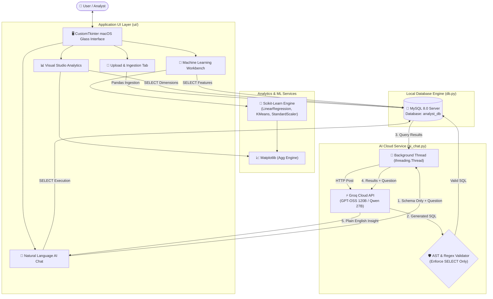

# 📊 AI Data Analyst — Intelligent Desktop Analytics Platform

> **Author:** K Mohith Kannan | **Affiliation:** SRMIST Kattankulathur, Chennai (Batch 2025–2029)  
> **Degree:** B.Tech CSE (Artificial Intelligence & Machine Learning)  
> **Course:** Python Lab / Capstone Project  
> **Architecture:** Desktop Client (Python 3.12 + CustomTkinter + MySQL + Scikit-Learn + Groq LLM Cloud)

---

## 🎯 Executive Summary & Purpose

Modern businesses sit on massive volumes of relational data stored across SQL databases and CSV reports, yet non-technical stakeholders (founders, managers, marketers) struggle with SQL syntax and complex statistical software.

**AI Data Analyst** bridges this divide by providing an elegant, macOS-inspired desktop analytics environment where users can:
1. **Ingest & Normalize:** Upload raw CSV files, automatically map datatypes, and persist them into a production MySQL engine.
2. **Visualize:** Generate high-resolution, dark-themed statistical charts (Bar, Trend Line, Donut/Pie, Distribution Histogram) embedded natively via matplotlib.
3. **Model & Predict:** Execute scikit-learn Machine Learning pipelines (Linear Regression with train/test splits & KMeans clustering with feature normalization).
4. **Natural Language AI Engine:** Chat with an autonomous AI data analyst powered by Groq's low-latency inference engine (OpenAI GPT-OSS 120B / Qwen 27B) that converts natural English questions into safe, optimized MySQL queries, executes them in real time, and synthesizes plain-English business takeaways.

---

## 🏗️ Architecture & Component Topology



---

## 🛠️ Complete Tech Stack & Design Rationale

| Layer | Technology | Version | Engineering Rationale |
|---|---|---|---|
| **Language** | Python | `3.12+` | Clean syntax, deep ecosystem for AI/ML, standard for academic viva & production prototyping. |
| **GUI Framework** | `customtkinter` | `6.0.0` | Elevates standard Tkinter with macOS-like dark themes, smooth rounded corners, anti-aliased widgets, and high-DPI scaling. |
| **Relational DB** | MySQL Server | `8.0+` | Full ACID-compliant relational DB engine; practices real-world SQL schemas and indexing rather than trivial in-memory SQLite. |
| **Database Connector** | `mysql-connector-python` | `26.10.0` | Native Oracle MySQL driver with prepared statements and parameter substitution. |
| **Data Ingestion** | `pandas` + `numpy` | `2.2.3` | High-speed vectorized data parsing, automatic type inference, missing value imputation, and memory footprint profiling. |
| **Visual Graphics** | `matplotlib` | `3.10.3` | Customized with non-interactive `'Agg'` backend and embedded via `FigureCanvasTkAgg` for seamless dark-theme rendering. |
| **Machine Learning** | `scikit-learn` | `1.9.1` | Industrial standard for classic ML; transparent, deterministic, and highly explainable in academic viva exams. |
| **AI Inference** | Groq Python SDK | `1.7.0` | Ultra-fast LPU (Language Processing Unit) inference delivering <500ms responses with open-weights LLMs. |
| **Secret Management** | `python-dotenv` | `1.0.1` | Enforces 12-factor app security principles by isolating credentials from source control. |

---

## 📁 Project Directory Anatomy

```
E:\ai_data_analyst\
├── main.py                     # Application bootstrap & DB health verification
├── .env                        # Local credentials (API keys, DB password) - Git-ignored
├── .gitignore                  # Git exclusions (.env, __pycache__, binaries)
├── db.py                       # MySQL schema creation, batch insertion, query executor
├── charts.py                   # Matplotlib chart builders (Bar, Line, Donut, Hist, Auto-picker)
├── ml.py                       # Scikit-Learn training pipelines (Linear Regression, KMeans)
├── ai_chat.py                  # Groq API client, Text-to-SQL compiler & Insight summarizer
├── README.md                   # Public repository documentation
├── PROJECT.md                  # Comprehensive technical dossier & Viva manual
├── sample_data/
│   └── sales_data.csv          # Multi-dimensional sample dataset for instant testing
└── ui/
    ├── __init__.py             # Python package marker
    ├── app.py                  # Main window with macOS header pill and tab routing
    ├── upload_tab.py           # Ingestion tab with Treeview preview and memory analytics
    ├── charts_tab.py           # Visualization studio with dynamic axis selectors
    ├── ml_tab.py               # ML workbench with automated numerical feature filtering
    └── chat_tab.py             # Dual-pane natural language AI assistant with live SQL box
```

---

## 🔒 Crucial Security & Architectural Decisions

### 1. Privacy-Preserving Schema Extraction
- **The Problem:** Sending full enterprise datasets to cloud LLMs violates GDPR/privacy policies and exhausts token limits instantly.
- **Our Solution:** The app uses `DESCRIBE [table]` to compile a lightweight schema representation (column names and data types). Only the **schema** and the **user's query** are sent to Groq. The actual rows of data never leave your local database server.

### 2. Defense-in-Depth SQL Firewall
- **The Problem:** LLMs can hallucinate destructive queries (`DROP TABLE`, `TRUNCATE`, `UPDATE`) or be manipulated via prompt injection.
- **Our Solution:** Every generated query must pass `validate_sql()`:
  - Whitelist: Only starts with `SELECT` or `WITH`.
  - Blacklist: Flags any occurrence of `DROP`, `DELETE`, `INSERT`, `UPDATE`, `ALTER`, `TRUNCATE`, `GRANT`, `REVOKE`.
  - Anti-Chaining: Forbids semicolons (`;`) inside the query string to prevent multiple statement execution attacks.

### 3. Asynchronous Worker Threading
- **The Problem:** Tkinter runs on a single main event loop (`app.mainloop()`). Any synchronous network HTTP call (like calling Groq API) locks the GUI, causing Windows to mark the window as "Not Responding".
- **Our Solution:** All AI queries execute inside background daemon threads (`threading.Thread(daemon=True)`). Results are dispatched back to the UI thread safely using `parent.after(0, ...)`.

---

## 🎓 Viva Voce & Academic Evaluation Guide

### Q1: Why use MySQL over SQLite?
> **Answer:** "SQLite is an embedded, serverless, file-based database intended for local storage. MySQL is a true enterprise client-server relational database supporting concurrent connections, granular user permissions, standard SQL isolation levels, and storage engines like InnoDB. Using MySQL demonstrates production database design and client-server connectivity."

### Q2: What is the $R^2$ score in Linear Regression?
> **Answer:** "The Coefficient of Determination ($R^2$) measures the proportion of variance in the dependent target variable that is predictable from the independent feature variable:
> $$R^2 = 1 - \frac{\sum (y_i - \hat{y}_i)^2}{\sum (y_i - \bar{y})^2}$$
> An $R^2$ of 1.0 indicates perfect prediction, while 0.0 means the model performs no better than simply predicting the mean."

### Q3: Why is `StandardScaler` mandatory before KMeans clustering?
> **Answer:** "KMeans relies on Euclidean distance:
> $$d(p, q) = \sqrt{\sum (p_i - q_i)^2}$$
> If one column is customer age (20–60) and another is annual income ($20,000–$150,000), the income column will dominate distance calculations by several orders of magnitude. `StandardScaler` standardizes each feature to mean $\mu = 0$ and variance $\sigma = 1$, giving equal geometric weight to every dimension."

### Q4: How does the AI generate auto-charts without user specification?
> **Answer:** "In `charts.py`, `create_auto_chart()` inspects the returned DataFrame's datatypes:
> - If 1 categorical column and 1 numeric column are returned $\rightarrow$ Bar Chart (or Donut if $\le 6$ slices).
> - If 2 numeric columns $\rightarrow$ Line Trend Plot.
> - If 1 numeric column $\rightarrow$ Distribution Histogram.
> This matches the visual dimension directly to the semantic data structure."

---

## 🚀 Future Roadmap & Entrepreneurial Opportunities

Looking to grow this beyond college into a commercial SaaS or open-source tool? Here are high-impact enhancement avenues:
1. **Multi-Database Support:** Add connectors for PostgreSQL, Snowflake, ClickHouse, and Google BigQuery using SQLAlchemy.
2. **Automated Data Quality Audit:** Integrate a profiling tab that highlights missing values, duplicates, outliers (Z-score/IQR), and skewness automatically upon upload.
3. **Automated PDF / PPTX Executive Reports:** Allow one-click export of the AI insights, charts, and query outputs into a branded executive slide deck using `python-pptx` or `weasyprint`.
4. **Local LLM Offline Mode:** Allow users with modern GPUs to run local quantized models via Ollama (e.g. Llama 3 8B or Mistral Nemo) with zero internet connection for ultra-sensitive corporate datasets.
5. **Interactive Data Studio:** Replace static charts with interactive Plotly / D3 canvases wrapped in web-view frames.
