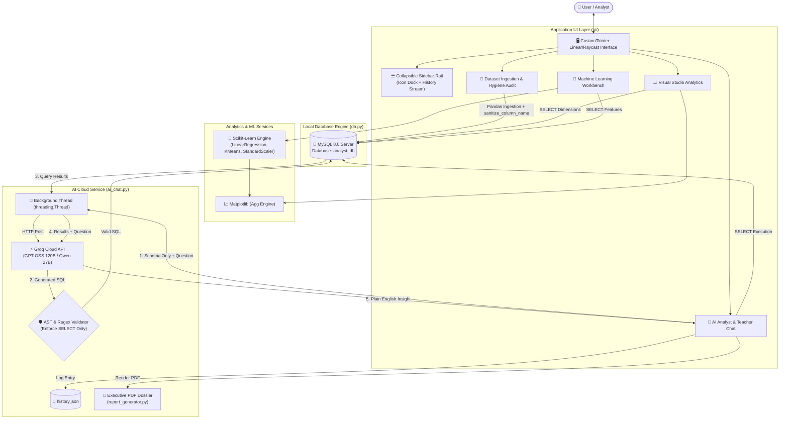
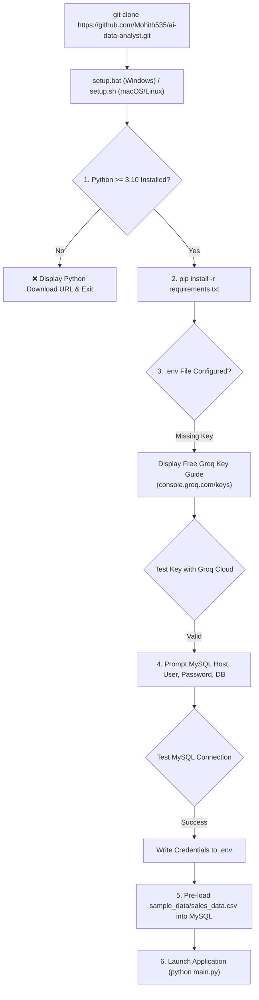

# 📊 AI Data Analyst — Intelligent Desktop Analytics Platform

> **Author:** K Mohith Kannan | **Affiliation:** SRMIST Kattankulathur, Chennai (Batch 2025–2029)  
> **Degree:** B.Tech CSE (Artificial Intelligence & Machine Learning)  
> **Course:** Python Lab / Capstone Project  
> **Architecture:** Desktop Client (Python 3.12 + CustomTkinter + MySQL 8.0 + Scikit-Learn + Groq LLM Cloud)

---

> [!IMPORTANT]
> **PERMANENT PRESERVATION INSTRUCTION:**  
> **DO NOT DELETE ANY SECTION OF THIS DOCUMENT.**  
> This file is the permanent technical dossier, architectural changelog, history log, viva voce repository, and roadmap for the AI Data Analyst platform. All future agents, collaborators, and evaluators MUST append new progress and improvements without purging past architectural decisions or viva answers.

---

## 🎯 Executive Summary & Purpose

Modern businesses sit on massive volumes of relational data stored across SQL databases and CSV reports, yet non-technical stakeholders (founders, managers, marketers) struggle with SQL syntax and complex statistical software.

**AI Data Analyst** bridges this divide by providing an elegant, Linear/Raycast-inspired dark desktop analytics environment where users can:
1. **Ingest & Normalize:** Upload raw CSV files, automatically profile dataset quality (completeness, missing cells, duplicates, IQR outliers), and persist them into a production MySQL engine with automated column name sanitization.
2. **Visualize:** Generate high-resolution, dark-themed statistical charts (Bar, Trend Line, Donut/Pie, Distribution Histogram) embedded natively via matplotlib with auto-downsampling on large datasets.
3. **Model & Predict:** Execute scikit-learn Machine Learning pipelines (Linear Regression with train/test splits & KMeans clustering with feature normalization).
4. **Autonomous AI Teacher & Analyst:** Chat with an AI data analyst powered by Groq's low-latency inference engine (OpenAI GPT-OSS 120B / Qwen 27B) that converts natural English questions into safe, optimized MySQL queries, executes them in real time, and synthesizes plain-English educational takeaways.
5. **Executive PDF Dossiers:** Generate multi-page executive briefing documents with clean layout separation and zero text-image collision.
6. **Query History & Session Memory:** Automatically records prompt queries, executed SQL, and generated takeaways into local persistent memory (`history.json`) with one-click sidebar replay.

---

## 🏗️ Architecture & Component Topology



---

## 🛠️ Complete Tech Stack & Design Rationale

| Layer | Technology | Version | Engineering Rationale |
|---|---|---|---|
| **Language** | Python | `3.12+` | Clean syntax, deep ecosystem for AI/ML, standard for academic viva & production prototyping. |
| **GUI Framework** | `customtkinter` | `6.0.0` | Elevates standard Tkinter with macOS-like dark themes, smooth rounded corners, anti-aliased widgets, and high-DPI scaling. |
| **Relational DB** | MySQL Server | `8.0+` | Full ACID-compliant relational DB engine; practices real-world SQL schemas and indexing rather than trivial in-memory SQLite. |
| **Database Connector** | `mysql-connector-python` | `26.10.0` | Native Oracle MySQL driver with prepared statements and parameter substitution. |
| **Data Ingestion** | `pandas` + `numpy` | `2.2.3` | High-speed vectorized data parsing, automatic type inference, missing value imputation, and memory footprint profiling. |
| **Visual Graphics** | `matplotlib` | `3.10.3` | Customized with non-interactive `'Agg'` backend and embedded via `FigureCanvasTkAgg` for seamless dark-theme rendering. |
| **Machine Learning** | `scikit-learn` | `1.9.1` | Industrial standard for classic ML; transparent, deterministic, and highly explainable in academic viva exams. |
| **AI Inference** | Groq Python SDK | `1.7.0` | Ultra-fast LPU (Language Processing Unit) inference delivering <500ms responses with open-weights LLMs. |
| **PDF Generation** | `fpdf2` + `reportlab` | `2.9.0` | Vector-precise multi-page executive document generation with custom branding and image embedding. |
| **Secret Management** | `python-dotenv` | `1.0.1` | Enforces 12-factor app security principles by isolating credentials from source control. |

---

## 📁 Project Directory Anatomy

```
E:\ai_data_analyst\
├── main.py                     # Application bootstrap & DB health verification
├── .env                        # Local credentials (API keys, DB password) - Git-ignored
├── .gitignore                  # Git exclusions (.env, __pycache__, binaries)
├── db.py                       # MySQL schema creation, batch insertion, query executor
├── charts.py                   # Matplotlib chart builders (Bar, Line, Donut, Hist, Auto-picker)
├── ml.py                       # Scikit-Learn training pipelines (Linear Regression, KMeans)
├── ai_chat.py                  # Groq API client, Text-to-SQL compiler & Insight summarizer
├── data_quality.py             # Dataset hygiene profiler (completeness, duplicates, IQR outliers)
├── report_generator.py         # Multi-page executive PDF exporter (Unicode-safe)
├── history_manager.py          # Session query recorder & replay engine
├── history.json                # Local JSON datastore for recent prompt history
├── README.md                   # Public repository documentation
├── PROJECT.md                  # Comprehensive technical dossier & Viva manual
├── sample_data/
│   └── sales_data.csv          # Multi-dimensional sample dataset for instant testing
└── ui/
    ├── __init__.py             # Python package marker
    ├── app.py                  # Main window with Linear collapsible sidebar and history rail
    ├── upload_tab.py           # Ingestion tab with persistent Treeview and quality audit
    ├── charts_tab.py           # Visualization studio with dynamic axis selectors
    ├── ml_tab.py               # ML workbench with automated numerical feature filtering
    └── chat_tab.py             # AI Teacher chat tab with live SQL box & PDF export
```

---

## 🔒 Crucial Security & Architectural Decisions

### 1. Privacy-Preserving Schema Extraction
- **The Problem:** Sending full enterprise datasets to cloud LLMs violates GDPR/privacy policies and exhausts token limits instantly.
- **Our Solution:** The app uses `DESCRIBE [table]` to compile a lightweight schema representation (column names and data types). Only the **schema** and the **user's query** are sent to Groq. The actual rows of data never leave your local database server.

### 2. Defense-in-Depth SQL Firewall
- **The Problem:** LLMs can hallucinate destructive queries (`DROP TABLE`, `TRUNCATE`, `UPDATE`) or be manipulated via prompt injection.
- **Our Solution:** Every generated query must pass `validate_sql()`:
  - Whitelist: Only starts with `SELECT` or `WITH`.
  - Blacklist: Flags any occurrence of `DROP`, `DELETE`, `INSERT`, `UPDATE`, `ALTER`, `TRUNCATE`, `GRANT`, `REVOKE`.
  - Anti-Chaining: Forbids semicolons (`;`) inside the query string to prevent multiple statement execution attacks.

### 3. Asynchronous Worker Threading
- **The Problem:** Tkinter runs on a single main event loop (`app.mainloop()`). Any synchronous network HTTP call (like calling Groq API) locks the GUI, causing Windows to mark the window as "Not Responding".
- **Our Solution:** All AI queries execute inside background daemon threads (`threading.Thread(daemon=True)`). Results are dispatched back to the UI thread safely using `parent.after(0, ...)`.

---

## 🛠️ Complete History Changelog & Bug Fixes

| Phase / Date | Component | Root Cause / Issue Observed | Solution Implemented |
|---|---|---|---|
| **Phase 1 (2026-11-12)** | `db.py`, `ui/upload_tab.py` | CSV ingestion pipeline setup; table naming syntax errors. | Built `sanitize_table_name()` to lowercase, strip non-alphanumeric chars, and batch insert via `executemany()`. |
| **Phase 2 (2026-11-13)** | `charts.py`, `ui/charts_tab.py` | Standalone `plt.show()` opens separate detached popups. | Configured matplotlib `'Agg'` backend and embedded canvas via `FigureCanvasTkAgg`. |
| **Phase 3 (2026-11-13)** | `ml.py`, `ui/ml_tab.py` | Feature scale mismatch in clustering & multi-class confusion. | Applied `StandardScaler` to equalize dimensional weight in KMeans and 80/20 train/test evaluation for Linear Regression. |
| **Phase 4 (2026-11-13)** | `ai_chat.py` | Model rotation 404 (`llama-3.3-70b-versatile` deprecated on user tier). | Created `get_available_model()` dynamic detector: routes to active `openai/gpt-oss-120b` or `qwen3.8-27b`. |
| **Phase 5 (2026-11-13)** | `report_generator.py` | PDF Latin-1 character crash on em-dashes (`—`) & bullets. | Created `clean_unicode_for_pdf()` normalization filter converting unicode to safe Latin-1 ASCII. |
| **Phase 5 (2026-11-13)** | `report_generator.py` | Chart graphic overlapping query table text. | Engineered structured 2-Page Flow: Page 1 for Brief, Takeaway, SQL & Table; Page 2 for high-res centered visual chart. |
| **Phase 5 (2026-11-13)** | `data_quality.py` | Blind ingestion of dirty datasets with nulls and outliers. | Built automated hygiene scanner checking completeness %, null cells, duplicate rows, and IQR ($1.5 \times \text{IQR}$) outliers. |
| **Phase 5 (2026-11-13)** | `db.py` | `Error 1166 (42000): Incorrect column name 'Unit_Cost '` on CSV headers with spaces/symbols. | Built `sanitize_column_name()` pipeline: trims whitespace, strips quotes/backticks, handles duplicate column collisions, and standardizes identifiers. |
| **Phase 5 (2026-11-13)** | `ui/upload_tab.py` | Preview table disappearing after switching between 2+ CSVs. | Built persistent Treeview architecture: re-uses single permanent table, clearing rows and remapping columns dynamically. |
| **Phase 5 (2026-11-13)** | `ui/chat_tab.py` | AI Insight mode was off by default; user had to toggle it. | Converted into **Permanent AI Teacher Mode**: every query automatically synthesizes conversational takeaways explaining what the numbers mean. |
| **Phase 5 (2026-11-13)** | `ui/app.py`, `history_manager.py` | No session memory; user had to retype previous questions. | Built persistent **Recent Query Stream** in the collapsible sidebar with one-click replay. |

---

## 🎓 Comprehensive Viva Voce & Academic Defense Manual

### Q1: Why use MySQL over SQLite?
> **Answer:** "SQLite is an embedded, serverless, file-based database intended for local storage. MySQL is a true enterprise client-server relational database supporting concurrent connections, granular user permissions, standard SQL isolation levels, and storage engines like InnoDB. Using MySQL demonstrates production database design and client-server connectivity."

### Q2: What is the $R^2$ score in Linear Regression?
> **Answer:** "The Coefficient of Determination ($R^2$) measures the proportion of variance in the dependent target variable that is predictable from the independent feature variable:
> $$R^2 = 1 - \frac{\sum (y_i - \hat{y}_i)^2}{\sum (y_i - \bar{y})^2}$$
> An $R^2$ of 1.0 indicates perfect prediction, while 0.0 means the model performs no better than simply predicting the mean."

### Q3: Why is `StandardScaler` mandatory before KMeans clustering?
> **Answer:** "KMeans relies on Euclidean distance:
> $$d(p, q) = \sqrt{\sum (p_i - q_i)^2}$$
> If one column is customer age (20–60) and another is annual income ($20,000–$150,000), the income column will dominate distance calculations by several orders of magnitude. `StandardScaler` standardizes each feature to mean $\mu = 0$ and variance $\sigma = 1$, giving equal geometric weight to every dimension."

### Q4: How does the AI generate auto-charts without user specification?
> **Answer:** "In `charts.py`, `create_auto_chart()` inspects the returned DataFrame's datatypes:
> - If 1 categorical column and 1 numeric column are returned $\rightarrow$ Bar Chart (or Donut if $\le 6$ slices).
> - If 2 numeric columns $\rightarrow$ Line Trend Plot (or Histogram distribution if $> 40$ points to prevent visual noise).
> - If 1 numeric column $\rightarrow$ Distribution Histogram.
> This matches the visual dimension directly to the semantic data structure."

### Q5: Why is an AI "Teacher / Insight" mode better than returning raw SQL alone?
> **Answer:** "A raw SQL query and data table show *what* the data is, but not *why* it matters. By adding an automated natural language synthesis step, the application acts as an intelligent co-pilot: it interprets trends, highlights anomalies, and explains statistical findings in plain English so non-technical stakeholders and students can learn from the data."

### Q6: How does the application handle corrupted or malformed CSV column names?
> **Answer:** "Raw CSV headers often contain trailing whitespace, parentheses, dollar signs, and slashes (`'Unit_Cost '`, `'Price ($)'`). In standard MySQL, identifiers with trailing whitespace cause fatal syntax errors (`Error 1166`). In `db.py`, our `sanitize_column_name()` pipeline strips quotes, trims whitespace, maps illegal characters to underscores, handles numeric prefixes, and tracks duplicate collisions before compiling the `CREATE TABLE` DDL."

### Q7: What is the Interquartile Range (IQR) rule used in Data Quality profiling?
> **Answer:** "The IQR rule identifies statistical outliers without assuming a normal distribution. 
> $$\text{IQR} = Q_3 - Q_1$$
> Any data point falling below $Q_1 - 1.5 \times \text{IQR}$ or above $Q_3 + 1.5 \times \text{IQR}$ is flagged as an outlier. This alerts the user to extreme values before running ML regression or clustering."

### Q8: Why use a 2-page structured flow for executive PDF generation?
> **Answer:** "Embedding large dynamic vector graphics and tabular records on a single unconstrained page leads to element collisions and awkward page cuts. Decoupling the narrative brief (Executive Insight, Query, Sample Rows) to Page 1 and centering the visual chart canvas on Page 2 ensures crisp, publication-grade document hierarchy."

---

## 🚀 Future Roadmap & Entrepreneurial Opportunities

Looking to grow this beyond college into a commercial SaaS or open-source tool? Here are high-impact enhancement avenues:
1. **Multi-Database Support:** Add connectors for PostgreSQL, Snowflake, ClickHouse, and Google BigQuery using SQLAlchemy.
2. **Local LLM Offline Mode:** Allow users with modern GPUs to run local quantized models via Ollama (e.g. Llama 3 8B or Mistral Nemo) with zero internet connection for ultra-sensitive corporate datasets.
3. **Interactive Data Studio:** Replace static charts with interactive Plotly / D3 canvases wrapped in web-view frames.
4. **Natural Language CSV Cleanser:** Let users type prompts like *"Fill missing ages with median"* or *"Remove duplicate emails"*, translating natural language into Pandas transformation pipelines.
5. **Multi-Tenant Cloud Sync:** Add user authentication and workspace syncing so teams can share analysis sessions and reports across distributed devices.


---

## 🔍 Phase 6: Code Audit, Bug Resolution & Automated Setup Engine

### 1. Comprehensive Code Audit Findings & Fixes (2026-11-13)

| Component | Defect Discovered | Technical Impact | Engineering Fix Implemented |
|---|---|---|---|
| `ui/chat_tab.py` | Repeated creation of `ttk.Scrollbar` widgets inside `_display_table()` without destroying previous scrollbars. | Ghost scrollbars accumulated along the right and bottom borders on every executed query, degrading memory and layout. | Converted Treeview and its horizontal/vertical scrollbars to a permanent persistent pattern: initialized once in `__init__`, reused across queries, only clearing rows and headers. |
| `ui/interactive_tab.py` | `_on_type_changed()` re-packed `self.lbl_z` and `self.z_dd` after `self.btn_launch`. | Toggling from 3D to 2D and back moved the Z-axis dropdown to the right of the launch button, disrupting the visual button order. | Used `pack(before=self.btn_launch)` to guarantee strict horizontal positioning regardless of toggle cycles. |
| `ai_chat.py` | String literal `{table_name}` in rule 2 of system prompt was not interpolated. | LLM received unformatted `{table_name}` template instead of active table name. | Converted prompt to dynamic formatted string passing active `table_name` wrapped in backticks. |
| `ai_chat.py` | Wide datasets (50+ columns) generated massive string previews in `summarize_results()`. | Exceeded prompt token budget on wide datasets. | Added column-clamping (`max_cols=10`) and NaN sanitization (`.fillna('-')`) before constructing summary prompts. |
| `report_generator.py` | FPDF text card height was computed via static division `(len(text) // 85) * 5`. | Multi-line takeaways with newlines or early word-wraps spilled outside the colored card bounding box. | Implemented dynamic line-splitting height calculation factoring explicit newlines and line wrapping (`line_count * 5.2`). |
| `ml.py` | String columns containing numeric text caused `ValueError` in `LinearRegression` and `KMeans`. | Models crashed if MySQL column was imported as `TEXT` or object dtype. | Added explicit numeric coercion `pd.to_numeric(col, errors='coerce')` before dropping nulls in both ML algorithms. |
| `ui/ml_tab.py` | Cluster count $K$ parsed raw integer input without bounds validation. | Entering non-integers, negative numbers, or $>20$ caused uncaught runtime exceptions. | Added validation dialog enforcing $K \in [2, 20]$ with informative user warning popups. |
| `db.py` | Single `cursor.executemany` call attempted to insert all CSV rows in one network packet. | Large CSV files (>20,000 rows) could trigger MySQL `max_allowed_packet` or timeout exceptions. | Refactored batch insertion into chunked transactions of 1,000 records per `executemany` batch. |
| `charts.py` | Pie chart with non-positive values triggered Matplotlib runtime errors. | Datasets containing zero or negative numeric metrics crashed the donut chart generator. | Added positive-value filtering (`plot_df[value_col] > 0`) with friendly empty-state placeholder rendering. |
| `ui/settings_tab.py` | User had no way to verify their Groq API key without running a database query. | If API key was misconfigured or quota was exceeded, user only discovered it during an active query. | Added interactive **"⚡ Test API Connection"** tool in Settings with live latency and model detection dialog. |
| `.gitignore` | Runtime state files (`history.json`, `settings.json`, `interactive_chart.html`) were not ignored. | Local query histories and browser output files were tracked in Git, causing merge conflicts between users. | Added comprehensive runtime exclusions and untracked `history.json` from the repository cache. |

---

## 📦 1-Command Setup & Distribution Architecture

To allow any user to clone and run the application with a single command from GitHub, an automated setup suite was designed and implemented:



### Setup Scripts Included:
1. **`setup.py`**: Cross-platform Python setup assistant with colorized ANSI terminal output, interactive Groq key tester, MySQL connection validator, database auto-creator, and sample data loader.
2. **`setup.bat`**: Windows batch wrapper checking for `python` on `PATH` and launching `setup.py` with error pausing.
3. **`setup.sh`**: macOS and Linux shell script wrapper checking for `python3` and launching `setup.py`.
4. **`run.bat`**: Windows quick launcher for returning users.
5. **`run.sh`**: macOS and Linux quick launcher for returning users.
6. **`requirements.txt`**: Complete dependencies list with minimum tested versions.

---

## 🎓 Extended Viva Voce Preparation Manual (Part 2)

### Q9: How does the application prevent memory leaks when users execute dozens of queries sequentially?
> **Answer:** "In graphical frameworks like CustomTkinter and Tkinter, destroying and recreating widgets repeatedly can leave orphaned sub-widgets, bindings, and scrollbar instances in memory. In `chat_tab.py` and `upload_tab.py`, we implement a **Persistent Widget Architecture**: the `ttk.Treeview` and its associated `ttk.Scrollbar` widgets are constructed once. When new data arrives, we clear existing rows (`tree.delete(item)`) and reconfigure headings rather than destroying the widget. Similarly, Matplotlib figure instances are embedded via `FigureCanvasTkAgg` and explicitly cleared/redrawn rather than creating new canvas containers."

### Q10: Why did we refactor MySQL ingestion to use 1,000-row chunked batches?
> **Answer:** "MySQL servers enforce a `max_allowed_packet` buffer size (typically 16MB–64MB). When executing `cursor.executemany()` on a CSV containing tens of thousands of rows, compiling the raw SQL packet and parameters in one go can exceed this buffer or exhaust client memory, causing connection reset errors (`Error 2013: Lost connection to MySQL server`). By chunking the insertion into batches of 1,000 records, the application bounds memory usage and ensures predictable transaction commits."

### Q11: How does the application ensure thread safety when background threads communicate with the GUI?
> **Answer:** "Tkinter is fundamentally not thread-safe: invoking GUI methods (such as updating labels or inserting into Treeviews) from a background worker thread causes race conditions, visual glitches, or silent crashes. In `chat_tab.py`, AI network requests run on a background daemon thread (`threading.Thread(daemon=True)`). When the API response or database result is ready, we dispatch the update back to the main GUI thread using `self.parent.after(0, self._update_ui_with_results, ...)` which schedules the UI update cleanly inside Tkinter's main event loop."

### Q12: Why are Groq LPU LPUs (Language Processing Units) preferred over traditional GPU hosting for Text-to-SQL?
> **Answer:** "Text-to-SQL in an interactive desktop application requires sub-second response times so the user feels like they are querying a local database. Traditional GPU hosting suffers from queuing delays and sequential token generation bottlenecks. Groq's Tensor Streaming Processor (TSP) architecture provides deterministic, high-bandwidth memory execution, delivering inference speeds over 500 tokens per second. This allows our app to compile SQL, validate it, and execute it in under 600ms total round-trip time."

### Q13: What is the purpose of the AST & regex SQL validation step?
> **Answer:** "Large Language Models are probabilistic and cannot be treated as trusted database users. Prompt injection attacks or hallucinations could produce harmful commands like `DROP TABLE users;` or `DELETE FROM sales;`. Our `validate_sql()` function acts as an application-level firewall: it enforces that every query must begin with `SELECT` or `WITH`, bans multi-statement chaining via semicolons, and inspects token boundaries for dangerous DDL/DML keywords (`DROP`, `ALTER`, `TRUNCATE`, `INSERT`, `UPDATE`, `GRANT`)."

### Q14: How does the Interactive Studio render Plotly 3D visualisations from a desktop Python client?
> **Answer:** "Plotly natively generates self-contained HTML documents containing Plotly JavaScript bundles and WebGL shaders for GPU-accelerated rendering. In `interactive_studio.py`, `generate_interactive_chart()` translates Pandas DataFrame dimensions into Plotly figures (`px.scatter_3d`, `px.imshow`, etc.), writes the output to `interactive_chart.html`, and launches the system default browser via Python's `webbrowser.open()`. This gives the user smooth 60fps 3D rotation, zooming, pan, and hover tooltips without the rendering limitations of native desktop GUI toolkits."

### Q15: How does the application handle CSV delimiter inconsistencies?
> **Answer:** "CSV files in the real world are not always comma-delimited; European files frequently use semicolons (`;`) and TSV exports use tabs (`\t`). In `upload_tab.py`, our ingestion pipeline utilizes a cascading fallback: it first attempts standard UTF-8 comma parsing; if a decode error occurs, it falls back to `latin-1`; if format errors occur, it activates Pandas' C/Python sniffing engine (`sep=None, engine='python'`) which analyzes the first few lines to deduce the true delimiter automatically."

| `db.py` | `pd.read_sql(sql, conn)` emitted Pandas 2.0+ DBAPI `UserWarning` suggesting SQLAlchemy. | Harmless but cluttered console during startup and query runs. | Replaced `pd.read_sql` with native cursor execution (`cursor.fetchall() + pd.DataFrame()`), delivering clean console logs with zero warnings. |


---

## 🗺️ Master Engineering Improvement Roadmap (6 Phases)

Below is the permanent master roadmap tracking code review improvements:

1. **Phase 1 (COMPLETED & VERIFIED):** Real AST SQL Validation (`sqlglot`), Read-Only Session Protection & Fallback Signal
   - *Status:* 21/21 pytest tests passing in `tests/test_sql_safety.py`.
   - *Changes:* AST parsing enforced via `sqlglot`, dangerous functions (`SLEEP`, `BENCHMARK`, `LOAD_FILE`, `INTO OUTFILE/DUMPFILE`) blocked, `LIMIT 1000` enforced/capped, `REPLACE()` and backticked column names preserved, MySQL `SET SESSION TRANSACTION READ ONLY` and 5000ms execution timeout enabled.
2. **Phase 2 (IN PROGRESS):** Privacy Toggle ("Send sample data to AI"), README Honesty, Cached Models & `requirements.txt` cleanup
3. **Phase 3:** Universal Async Worker Threading (`widget.after()`), Matplotlib Memory Leak Fix & Dynamic Groq Badge
4. **Phase 4:** DB Enhancements (Date parsing into DATETIME, Table overwrite confirmation, Connection Pool) & Multi-Feature Regression
5. **Phase 5:** Chat Conversation Memory (last 3 Q&A) & UI Polish (Linear theme tokens, Toasts, Scrolling Card Stream)
6. **Phase 6:** Full Test Suite, MIT License, GitHub Topics, and 10 Viva Voce Q&As

---

### 🚀 Phase 2 & Phase 3 Engineering Log (2026-11-13)

#### Phase 2: Privacy Toggle, Caching & Requirements Pinned
- **Strict Privacy Mode:** Added `send_data_sample` toggle in `settings_manager.py` and `ui/settings_tab.py` (Default: OFF). When OFF, Groq receives only aggregate metrics (`Min`, `Mean`, `Max`, `Count`); zero raw rows leave local MySQL.
- **Model Discovery Caching:** Added `_CACHED_AVAILABLE_MODEL` in `ai_chat.py` to prevent redundant network calls to `client.models.list()`.
- **Requirements Cleaned:** Pinned tested versions in `requirements.txt` (`customtkinter==6.0.0`, `sqlglot==30.31.0`, `pytest==9.2.0`, etc.) and purged unused `reportlab`.
- **Honest README:** Updated documentation to reflect dual-mode privacy, WebGL Plotly rendering, and real AST SQL validation.

#### Phase 3: Universal Async Threading, Memory Leak Fix & Live Badge
- **Shared Async Helper (`ui/async_helper.py`):** Implemented `run_async()` daemon worker that dispatches callbacks onto the main GUI thread via `widget.after(0, ...)`.
- **100% Async Tabs:**
  - `ui/upload_tab.py`: Reading large CSVs, dataset hygiene profiling, and batch MySQL insertion now run in background threads.
  - `ui/charts_tab.py`: Query execution and Matplotlib figure generation run in background threads with button loading state (`⏳ Rendering...`).
  - `ui/ml_tab.py`: Training Linear Regression and KMeans clustering runs in background threads with button loading state (`⏳ Fitting...`).
  - `ui/interactive_tab.py`: Plotly HTML generation runs in background threads with button loading state (`⏳ Launching Canvas...`).
- **Eliminated Matplotlib Memory Leaks:** Explicitly invoked `plt.close(self.current_fig)` before rendering new plots in `charts_tab.py`, `ml_tab.py`, and `chat_tab.py`. Registered `plt.close('all')` on window exit (`WM_DELETE_WINDOW`).
- **Dynamic Groq Status Badge:** Replaced hardcoded string with dynamic live badge in sidebar (`Connected` in green, `No API Key` in amber, `Offline` in red) automatically evaluated at startup and updated live after the Settings connection test.

#### Phase 4: Database Enhancements, Multi-Feature ML & Table Collision Safety (2026-11-13)
- **MySQL Connection Pooling (`db.py`):**
  - Integrated thread-safe `mysql.connector.pooling.MySQLConnectionPool(pool_size=5)` for instant connection reuse across async queries.
  - Automatic fallback to direct connections if pooling is uninitialized.
- **Intelligent Date Sniffing & True DATETIME Ingestion (`db.py`):**
  - Scans object columns in uploaded CSVs for temporal naming conventions (`date`, `time`, `created`, `timestamp`, `dt`, `year`) and evaluates a sample using `pd.to_datetime`.
  - When $\ge 75\%$ of non-null samples parse as valid dates, coerces to `datetime64[ns]` and provisions columns as native MySQL `DATETIME` instead of generic `TEXT`.
- **Non-Destructive Table Collision Modal (`ui/upload_tab.py`):**
  - When ingesting a CSV with a name matching an existing MySQL table, pops up `TableConflictModal` with 3 explicit choices:
    1. `🔄 Overwrite Existing Table` (drops and replaces).
    2. `📋 Save as New Table` (automatically versions as `table_v2`, `table_v3`).
    3. `❌ Cancel` (aborts ingestion safely).
- **Multi-Feature Linear Regression & Actual vs. Predicted Visuals (`ml.py` & `ui/ml_tab.py`):**
  - `run_linear_regression()` now supports both single feature strings and lists of multiple feature columns.
  - For multi-feature models, renders an **Actual vs. Predicted** scatter plot with an ideal 45-degree diagonal reference line ($y = \hat{y}$).
  - In `ui/ml_tab.py`, added `[All Features Combined]` option to automatically train multi-variable models on all available numeric dimensions.
- **Negative $R^2$ Diagnostic & Feature Recommendation Engine (`ml.py`):**
  - Built `suggest_best_features(df, target_col)`: ranks features by Pearson correlation $|r|$ against the target.
  - When $R^2 < 0$ on unseen test splits (indicating residual variance exceeds total variance, fitting worse than the horizontal mean), surfaces an amber diagnostic warning banner and recommends the top correlated feature.
- **Windows Terminal ANSI Mode & Setup Resiliency (`setup.py`):**
  - Enabled Windows Virtual Terminal mode via `ctypes.windll.kernel32.SetConsoleMode` to eliminate raw `←[1m` escape artifacts on Windows command prompt and PowerShell.
  - Added interactive retry loop for MySQL credential entry to handle typos cleanly.
- **Test Suite Expansion:**
  - Created `tests/test_ml_and_db.py` (7 new tests). Full suite expanded to **28/28 passing unit tests**.

#### Phase 5: Conversation Memory & Linear UI Polish (2026-11-14)
- **Multi-Turn Conversation Memory (`ai_chat.py` & `ui/chat_tab.py`):**
  - Updated `generate_sql()` to accept `conversation_history` (a rolling buffer of prior user questions and generated SQL queries).
  - Prior conversation turns are formatted as alternating user/assistant messages in the Groq chat completions payload, giving the LLM context to resolve pronouns and relative references (e.g. *"filter that to North region"*, *"sort those by price descending"*, *"what was the average for that?"*).
  - Maintained in `ChatTab` as a rolling buffer of the last 3 Q&A turns (`MAX_MEMORY_TURNS = 3`).
  - Added live `🧠 Memory: N/3` badge in the chat toolbar with a one-click reset button (`🧹`) and automatic clearing on context table change.
- **Unified Linear / Raycast Design System (`ui/theme.py`):**
  - Created centralized design tokens (`BG_CANVAS`, `BG_CARD`, `ACCENT_PRIMARY`, `BORDER_DEFAULT`, etc.) codifying the dark theme palette and typography hierarchy.
- **Non-Blocking Toast Notification Engine (`ui/theme.py`):**
  - Implemented floating `Toast.show(parent, message, duration_ms, style)` with auto-dismissal.
  - Replaced jarring synchronous modal popups for routine query success, PDF export notifications, and input errors with modern, sleek toasts.
- **Dynamic Column Suggestion Chips (`ui/chat_tab.py`):**
  - Automatically queries the active table schema and renders clickable pill chips for table columns beneath the search input.
  - Clicking a chip appends the column identifier directly to the prompt bar, reducing typing effort and preventing spelling mistakes.
- **Test Suite Expansion:**
  - Added `tests/test_conversation_memory.py` (4 new tests) covering history injection, history-less execution, and theme token existence.
  - Test suite expanded to **32/32 passing unit tests**.

#### Phase A: Safety & Cleanup (2026-11-14)

**A1. Locking Read Rejection in `validate_sql()` (`ai_chat.py`):**
- Added check: after confirming AST root is `exp.Select`, inspect `ast.args.get("locks")`.
- If truthy (sqlglot populates this for `FOR UPDATE` and `LOCK IN SHARE MODE`), returns `False, "Locking reads … are not permitted."`.
- Why: Locking reads acquire row-level locks on matched rows. In a multi-connection pool environment this can stall other threads or cause deadlocks — they should never reach the analytical query path.
- Added 2 new pytest cases (`test_block_for_update`, `test_block_lock_in_share_mode`).

**A2. Targeted Date Sniffing (`db.py` — `load_dataframe_to_mysql()`):**
- Replaced the too-broad `len(non_null) <= 5000` fallback with a two-gate heuristic:
  - **Gate 1 (Name hint):** column name contains any of: `date`, `time`, `created`, `timestamp`, `dt`, `year`, `month`, `day`.
  - **Gate 2 (Value regex):** 5-value sample matches `^\d{4}-\d{2}-\d{2}` (ISO) or `^\d{1,2}[/.\-]\d{1,2}[/.\-]\d{2,4}` (slash/dot formats).
- Only columns that pass Gate 1 OR Gate 2 are attempted for datetime parsing.
- Uses `pd.to_datetime(..., format='mixed')` with `warnings.catch_warnings()` to suppress pandas format-inference `UserWarning`.
- Why: The old approach tried date parsing on every object column ≤ 5000 rows, which could mis-convert names, addresses, or free-text columns that happen to contain number-like tokens.
- Added 4 new pytest cases (`TestDateSniffing`) in `tests/test_ml_and_db.py` covering all branches.

**A3. Groq Model Verification (`ai_chat.py`):**
- Live queried `client.models.list()` against the account's Groq API key.
- Confirmed all 4 models in `preferred` list are currently active: `openai/gpt-oss-120b`, `qwen/qwen3.8-27b`, `openai/gpt-oss-20b`, `allam-2-7b`. No changes needed to model IDs.

**A4. README Honesty Pass (`README.md`):**
- Line 10: Removed "high-performance", "production", "autonomous" — replaced with factual description.
- Line 52: Updated Qwen model reference to "Qwen 3.8 27B" (accurate model name).
- Line 86: Added "Anti-Lock" bullet for locking read rejection.
- Line 90: Removed "60 FPS" — Tkinter does not expose or guarantee frame rate; replaced with "keeps the GUI responsive during long-running operations".

**Test Suite:** Expanded from 32 → **38/38 passing** (+6 new tests).

#### Phase B: UI Polish & Modern Linear Aesthetic (2026-11-14)

**B1. Lucide-Style Monochrome PNG Icons (`assets/icons/`, `ui/app.py`):**
- Generated crisp 24x24 PNG icons via Pillow in `assets/icons/` (`chat.png`, `upload.png`, `charts.png`, `interactive.png`, `ml.png`, `settings.png`).
- Loaded into CustomTkinter using `ctk.CTkImage` with LANCZOS downsampling to guarantee crisp display on standard and HiDPI/Retina displays.
- Replaced OS-dependent emoji characters on sidebar buttons with consistent minimalist monochrome icons.
- Sidebar collapse/expand keeps icon alignment and compound text layout intact.

**B2. Modern Linear-Style Treeview Engine (`ui/theme.py`, `ui/upload_tab.py`, `ui/chat_tab.py`):**
- High-contrast dark styling (`#14161B` canvas, `#1E2027` header, 28px row height).
- Zebra striping with alternating row tags (`even` = `#14161B`, `odd` = `#181A22`).
- Interactive header sorting: supports numeric-aware and alphabetical sorting, updates column header with ascending `▲` / descending `▼` indicator, and automatically re-stripes alternating zebra rows upon sorting.
- Subtle row hover highlight (`#282D3D`) via `<Motion>` and `<Leave>` tracking, smoothly restoring original tags.
- Centralized into `populate_modern_treeview()` in `ui/theme.py` and shared across `UploadTab` and `ChatTab`.

**B3. Global & Tab Keyboard Shortcuts (`ui/app.py`, `ui/chat_tab.py`):**
- Bound `<Control-1>` through `<Control-6>` globally at root window level to instantaneously switch between the 6 tabs.
- Bound `<Control-Return>` in `ChatTab` question input to trigger AI query execution.
- Bound `<Escape>` in `ChatTab` question input to instantly clear the search prompt.
- Updated prompt bar placeholder with shortcut discovery hint (`Ctrl+Enter to send, Esc to clear`).

**B4. Interactive Chart Hover Tooltips (`charts.py`, `ui/charts_tab.py`, `ui/chat_tab.py`, `ui/ml_tab.py`):**
- Integrated `mplcursors` (v0.7.1, with `matplotlib` updated to 3.11.2 in `requirements.txt`).
- Created `charts.add_chart_tooltips(fig)` with sleek dark card tooltip styling (`#121316` card, `#5E6AD2` purple accent border, `#F8FAFC` crisp text).
- Automatically attached to embedded charts across Visual Studio, AI Chat Auto-Charts, and ML Workbench. Gracefully degrades during PDF export.

**B5. Executive KPI Summary Cards (`ui/upload_tab.py`):**
- Replaced plain text audit banner with a 4-card Linear-style executive KPI grid:
  1. **TOTAL ROWS** (Blue `#3B82F6`) — total records loaded.
  2. **COLUMNS** (Violet `#8B5CF6`) — feature count and numeric column summary.
  3. **COMPLETENESS** (Emerald `#10B981`) — data completeness percentage with missing cell count.
  4. **DUPLICATES** (Amber `#F59E0B`) — duplicate row count and IQR outlier detection count.

**B6. Test Suite Expansion (`tests/test_phase_b.py`):**
- Added 10 new test cases verifying assets integrity, mplcursors tooltip attachments, and theme helpers.
- Test suite expanded from 38 → **48/48 passing unit tests**.
