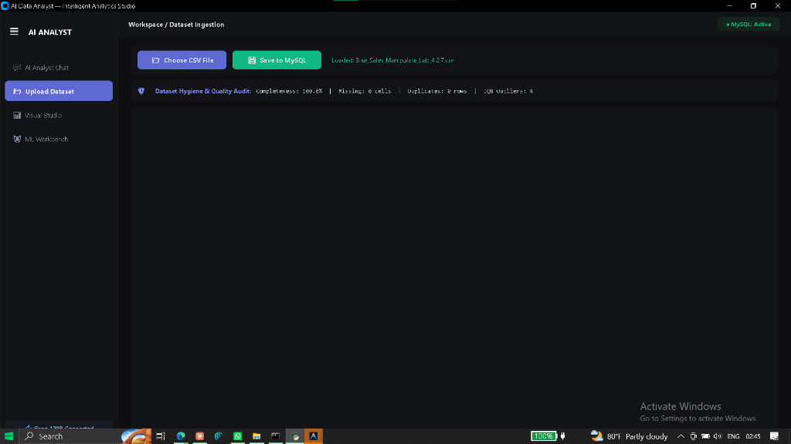
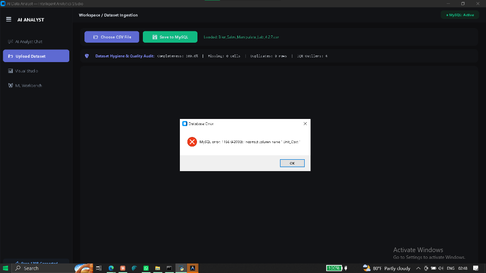
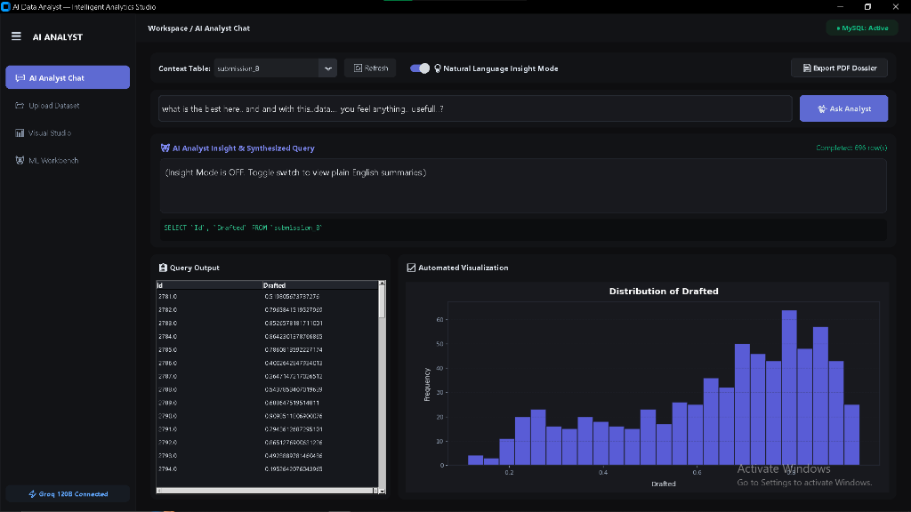
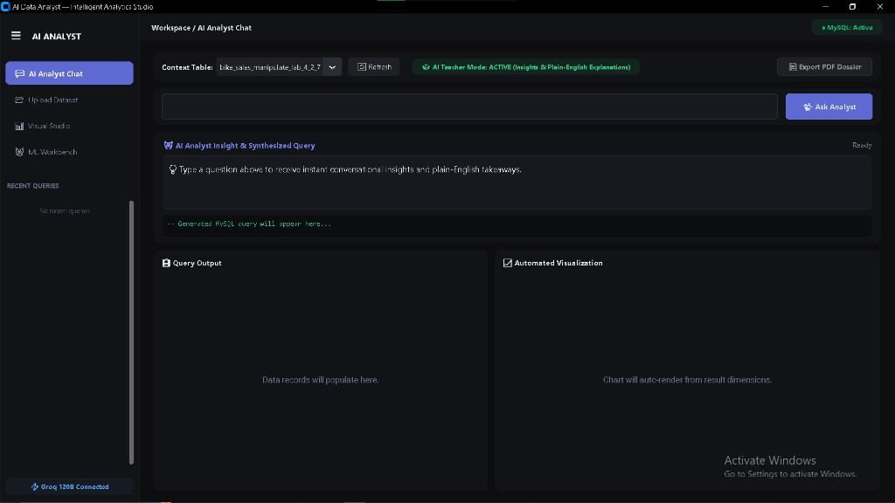
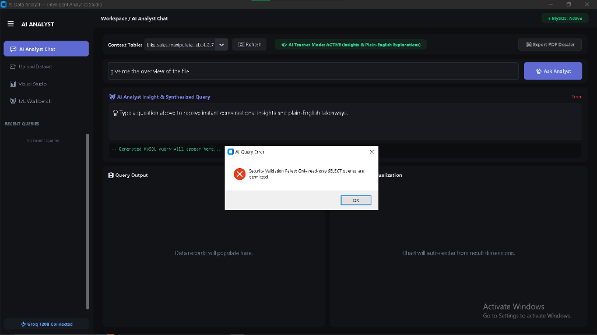

# 📊 AI Data Analyst — Intelligent Desktop Analytics Platform

[](https://python.org)
[](https://github.com/TomSchimansky/CustomTkinter)
[](https://mysql.com)
[](https://scikit-learn.org)
[](https://groq.com)
[](https://plotly.com)
[](LICENSE)

A Linear/Raycast-inspired dark desktop analytics platform built with Python. Ingest datasets, automatically audit hygiene & statistical outliers, persist to a local MySQL database with column sanitization, render Matplotlib & interactive Plotly 3D visualisations, fit explainable Scikit-Learn Machine Learning models, and converse with an AI Analyst powered by Groq's fast inference engine.

---

## ⚡ 1-Command Quickstart

Clone the repository and launch the automated setup wizard:

### On Windows:
```cmd
git clone https://github.com/Mohith535/ai-data-analyst.git
cd ai-data-analyst
setup.bat
```

### On macOS / Linux:
```bash
git clone https://github.com/Mohith535/ai-data-analyst.git
cd ai-data-analyst
chmod +x setup.sh run.sh
./setup.sh
```

### Or using Python directly:
```bash
git clone https://github.com/Mohith535/ai-data-analyst.git
cd ai-data-analyst
python setup.py
```

The automated setup wizard will:
1. Verify Python version ($\ge 3.10$)
2. Automatically install all dependencies (`pip install -r requirements.txt`)
3. Help you get and verify your **100% Free Groq API Key**
4. Configure and test your local **MySQL database**
5. Pre-load the bundled sample dataset (`sales_data.csv`) into MySQL
6. Launch the AI Data Analyst application!

---

## 🔑 How to Get Your Free Groq API Key

The natural language AI features are powered by Groq's low-latency LPU Cloud (OpenAI GPT-OSS 120B & Qwen 3.8 27B):

1. Go to [https://console.groq.com/keys](https://console.groq.com/keys)
2. Sign in with Google or GitHub (free, no credit card required)
3. Click **"Create API Key"**, give it a name, and copy the key (starts with `gsk_`)
4. Paste it into the `setup.bat` prompt or into your `.env` file:
   ```env
   GROQ_API_KEY=gsk_your_groq_api_key_here
   ```

---

## 🖥️ Platform Workspace Architecture

The application is structured into 6 specialized tabs accessible via the collapsible Linear-style sidebar (`☰`):

| Tab | Purpose | Key Capabilities |
|---|---|---|
| 💬 **AI Analyst Chat** | Conversational Business Intelligence | Natural English $\rightarrow$ MySQL 8.0 `SELECT` compilation, automated plain-English takeaways (AI Teacher Mode), auto-charting, and 2-page Executive PDF Dossier export. |
| 📂 **Upload Dataset** | Data Ingestion & Quality Audit | CSV file loading with delimiter sniffing, persistent high-contrast data table preview, and automated hygiene profiling (completeness %, duplicate count, null count, IQR outliers). |
| 📊 **Visual Studio** | Statistical Visual Analytics | High-resolution Matplotlib charts (Bar, Trend Line, Donut/Pie, Distribution Histogram) styled in macOS dark aesthetics with smart downsampling. |
| 🌐 **Interactive Studio** | Interactive 3D & Zoomable Canvas | Interactive Plotly 3D scatter plots, zoomable lines, box-plot quartile distributions, and correlation heatmaps opened in your browser using WebGL. |
| 🤖 **ML Workbench** | Machine Learning Pipelines | **Linear Regression** (80/20 train/test evaluation, $R^2$ score, MAE, dynamic equation line) and **K-Means Clustering** ($K \in [2, 20]$, `StandardScaler` normalization, centroids). |
| ⚙️ **Settings & Prefs** | System Customization | Toggle AI Teacher Mode ON/OFF, toggle auto-charts, toggle Privacy Mode (zero raw rows sent to AI), clear recent query cache, and test live Groq API connectivity. |

### 📸 Visual Workspace Gallery

<div align="center">

| 💬 **AI Analyst Chat & Auto-Visualizations** | 📂 **Dataset Ingestion & Quality Audit** |
|:---:|:---:|
|  |  |

| 📊 **Visual Studio (Matplotlib Dark Theme)** | 🤖 **Machine Learning Workbench** |
|:---:|:---:|
|  |  |

| 🌐 **Interactive 3D Studio (WebGL)** | ⚙️ **System Settings & Privacy Toggles** |
|:---:|:---:|
|  |  |

</div>

### ⌨️ Productivity Keyboard Shortcuts

| Shortcut | Action | Scope |
|:---:|---|---|
| `Ctrl + 1` | Switch to AI Analyst Chat | Global (Any Tab) |
| `Ctrl + 2` | Switch to Dataset Ingestion | Global (Any Tab) |
| `Ctrl + 3` | Switch to Visual Studio Analytics | Global (Any Tab) |
| `Ctrl + 4` | Switch to Interactive 3D Studio | Global (Any Tab) |
| `Ctrl + 5` | Switch to Machine Learning Workbench | Global (Any Tab) |
| `Ctrl + 6` | Switch to Settings & Preferences | Global (Any Tab) |
| `Ctrl + Enter` | Submit natural language question to Groq AI | AI Analyst Chat |
| `Escape` | Clear question input bar | AI Analyst Chat |

---

## 🔒 Security & Privacy Architecture

- **Privacy-First Data Architecture:** By default, raw data records **never** leave your local MySQL instance. When translating English to SQL, only the lightweight table schema (`DESCRIBE table`) is sent to Groq. When generating plain-English takeaways, only aggregate statistical summaries (min, mean, max, row count) are transmitted. Users can optionally toggle *"Send Data Sample to AI"* in Settings if they want the AI to cite specific row values.
- **AST SQL Injection Firewall:** Every generated query is parsed into an Abstract Syntax Tree using `sqlglot` (MySQL dialect) before execution:
  - **Single Statement Enforcement:** Allows exactly one statement of type `SELECT` or `WITH ... SELECT` (CTEs).
  - **DDL/DML Ban:** Structurally blocks `INSERT`, `UPDATE`, `DELETE`, `DROP`, `ALTER`, `CREATE`, and `TRUNCATE`.
  - **Anti-Exfiltration:** Blocks file output clauses (`INTO OUTFILE` and `INTO DUMPFILE`).
  - **Anti-DoS:** Rejects server-freezing functions (`SLEEP()`, `BENCHMARK()`, `LOAD_FILE()`).
  - **Anti-Lock:** Rejects locking reads (`FOR UPDATE`, `LOCK IN SHARE MODE`) that could cause deadlocks.
  - **Automatic Row Capping:** Automatically injects or caps queries to `LIMIT 1000`.
- **Database Session Defense-in-Depth:** All analytical queries run with `SET SESSION TRANSACTION READ ONLY` and a 5,000ms execution timeout (`max_execution_time`).
- **Self-Healing SQL Fallback:** If the LLM generates conversational text or non-SELECT output on broad prompts, the system automatically catches it and falls back to a clean overview query (`SELECT * FROM table LIMIT 25`) with a clear user notification banner.
- **Threaded Execution:** All AI inference and database operations run in daemon background threads (`threading.Thread`) to keep the CustomTkinter GUI responsive during long-running operations.

---

## 📁 Repository Structure

```
ai-data-analyst/
├── main.py                     # Application entry point & DB connection check
├── setup.py                    # Cross-platform interactive setup wizard
├── setup.bat                   # 1-click Windows installer batch script
├── setup.sh                    # 1-click macOS / Linux installer shell script
├── run.bat                     # Windows 1-click quick launcher
├── run.sh                      # macOS / Linux quick launcher
├── requirements.txt            # Pinned dependency specification
├── db.py                       # MySQL schema creation, batch insertion & query executor
├── charts.py                   # Matplotlib chart helpers (Agg non-interactive backend)
├── ml.py                       # Scikit-Learn training pipelines (Linear Regression, KMeans)
├── ai_chat.py                  # Groq API client, Text-to-SQL compiler & Insight summarizer
├── data_quality.py             # Dataset hygiene profiler (completeness, duplicates, IQR outliers)
├── report_generator.py         # Multi-page executive PDF dossier exporter (Unicode-safe)
├── history_manager.py          # Session query recorder & replay engine
├── settings_manager.py         # Persistent JSON settings manager
├── interactive_studio.py       # Plotly 3D & interactive HTML canvas engine
├── sample_data/
│   └── sales_data.csv          # Sample multi-dimensional dataset for instant testing
├── ui/
│   ├── __init__.py             # UI package marker
│   ├── app.py                  # Main shell with collapsible Linear sidebar & history dock
│   ├── upload_tab.py           # Ingestion tab with persistent Treeview & hygiene audit
│   ├── charts_tab.py           # Visualization studio with dynamic axis selectors
│   ├── chat_tab.py             # Dual-pane AI chat tab with live SQL box & PDF export
│   ├── ml_tab.py               # ML workbench with automated numerical feature filtering
│   ├── interactive_tab.py      # Plotly 3D studio controls & browser launcher
│   └── settings_tab.py         # Preferences tab (AI Teacher toggle & API tester)
├── PROJECT.md                  # Comprehensive engineering dossier & Viva Voce Q&A
└── README.md                   # Public project documentation & quickstart
```

---

## 🎓 Academic Viva Voce Highlights

Developed for B.Tech CSE (AI & ML) evaluation at SRMIST Chennai. Core concepts covered:
- **Relational vs. Embedded DB:** Why client-server MySQL with ACID compliance and indexing is preferred over file-based SQLite for multi-user analytics.
- **Feature Standardization:** Why `StandardScaler` ($z = \frac{x - \mu}{\sigma}$) is mandatory before KMeans Euclidean distance calculation.
- **Regression Evaluation:** Mathematical definition of $R^2$ (Coefficient of Determination) and Mean Absolute Error (MAE).
- **Outlier Detection:** The Interquartile Range rule ($\text{IQR} = Q_3 - Q_1$, bounds $= [Q_1 - 1.5\text{IQR}, Q_3 + 1.5\text{IQR}]$) for distribution-free anomaly detection.
- **Event-Driven Asynchronous UI:** Separation of Tkinter's single-threaded event loop from background network/database worker threads using `parent.after(0, ...)`.

*(See [PROJECT.md](PROJECT.md) for the architectural dossier and [VIVA_QUESTIONS.md](VIVA_QUESTIONS.md) for the 30 Viva Voce questions & answers).*

---

## 🏷️ Recommended GitHub Metadata

- **Repository Description:**  
  `Linear-inspired dark desktop analytics studio with AST SQL firewall, Groq text-to-SQL, ML pipelines & interactive 3D visualizations.`
- **Repository Topics:**  
  `python`, `customtkinter`, `mysql`, `groq`, `data-analyst`, `machine-learning`, `scikit-learn`, `matplotlib`, `plotly`, `sqlglot`, `data-visualization`, `desktop-app`, `fpdf2`, `mplcursors`

---

## 📄 License

This project is open-source and available under the [MIT License](LICENSE).

---

## 👨‍💻 Author

**K Mohith Kannan**  
B.Tech CSE (Artificial Intelligence & Machine Learning)  
SRM Institute of Science and Technology (SRMIST), Kattankulathur, Chennai  
GitHub: [@Mohith535](https://github.com/Mohith535)
